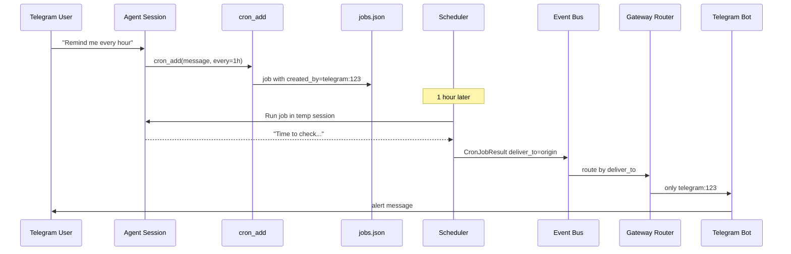

# Plan: Cron Delivery Routing

## Goal

Route cron job results to the client that created the job (or a specified target) instead of broadcasting to all connected clients.

## Current State

**Problem in [`internal/scheduler/scheduler.go`](../../internal/scheduler/scheduler.go) (lines 244–260):**

```go
event_bus.Publish(event.Event{
    Type: event.CronJobResult,
    // ...
    SessionID: "",  // empty = broadcast to ALL clients
})
```

**Router behavior in [`internal/gateway/router.go`](../../internal/gateway/router.go) (lines 329–336):**

```go
if be.SessionID == "" {
    consumers = r.allConsumers()  // everyone gets cron results
}
```

This breaks as soon as multiple users/clients connect — everyone sees everyone else's scheduled alerts.

---

## Design

### Delivery Target on CronJob

Extend [`internal/cron/job.go`](../../internal/cron/job.go):

```go
type DeliveryTarget struct {
    Kind     string `json:"kind"`               // "origin" | "client" | "broadcast" | "silent"
    ClientType     string `json:"client_type,omitempty"`     // "tui" | "telegram"
    ClientIdentity string `json:"client_identity,omitempty"`   // e.g. "default", chat ID
}

type CronJob struct {
    // existing fields...
    DeliverTo DeliveryTarget `json:"deliver_to"`
    CreatedBy ClientRef      `json:"created_by,omitempty"`
}

type ClientRef struct {
    Type     string `json:"type"`
    Identity string `json:"identity"`
}
```

| `Kind` | Behavior |
|--------|----------|
| `origin` | Deliver to `created_by` client (default for agent-created jobs) |
| `client` | Deliver to explicit `client_type` + `client_identity` |
| `broadcast` | All connected clients (current behavior, opt-in) |
| `silent` | Never deliver; record in job history only |

Default for new jobs: `kind: "origin"`.

### Capture Creator at Job Creation

When the agent calls `cron_add` during a user session, record which client owns that session.

**Flow:**

1. `RunContext` already carries `SessionID` ([`internal/tools/tools.go`](../../internal/tools/tools.go))
2. Session metadata has `ClientType` + `ClientIdentity` ([`internal/session/metadata_repo.go`](../../internal/session/metadata_repo.go))
3. `cron_add` looks up session metadata → sets `created_by` and `deliver_to: { kind: "origin" }`

### Route CronJobResult Events

Two options for routing — **Option A recommended:**

#### Option A: Target client on event payload

Extend [`internal/event/payloads.go`](../../internal/event/payloads.go):

```go
type CronJobResultPayload struct {
    JobID          string    `json:"job_id"`
    JobName        string    `json:"job_name"`
    Content        string    `json:"content"`
    Timestamp      time.Time `json:"timestamp"`
    DeliverTo      DeliveryTarget `json:"deliver_to,omitempty"`
}
```

Router checks `DeliverTo` for `CronJobResult` events:

```go
if routerEvent.Type == event.CronJobResult {
    payload := be.Payload.(event.CronJobResultPayload)
    consumers = r.consumersForDeliveryTarget(payload.DeliverTo)
    // fall back to broadcast if target not connected
}
```

#### Option B: Use ClientIdentity on event envelope

Set `event.ClientType` / `event.ClientIdentity` fields on the bus event. Requires extending `event.Event` struct.

**Go with Option A** — keeps delivery logic in the payload, doesn't change the generic event envelope.

---

## Implementation Steps

### 1. Extend CronJob schema

**File:** [`internal/cron/job.go`](../../internal/cron/job.go)

Add `DeliveryTarget`, `ClientRef`, `DeliverTo`, `CreatedBy` fields. Default `DeliverTo.Kind = "origin"` in `NewEveryJob` / `NewAtJob`.

Add validation: `client` kind requires both type and identity.

### 2. Migration for existing jobs

**File:** [`internal/cron/store.go`](../../internal/cron/store.go)

On load, if `deliver_to` is missing → default to `{ kind: "broadcast" }` to preserve current behavior for existing jobs.

### 3. Capture creator in cron_add

**File:** [`internal/tools/cron.go`](../../internal/tools/cron.go)

- Add `sessionLookup` interface (or use existing session manager via global setter, same pattern as `SetCronService`)
- In `cronAddExec`: resolve `RunContext.SessionID` → metadata → set `CreatedBy` and `DeliverTo`

```go
job.CreatedBy = ClientRef{Type: meta.ClientType, Identity: meta.ClientIdentity}
job.DeliverTo = DeliveryTarget{Kind: "origin"}
```

### 4. Add `deliver_to` param to cron_add tool

**File:** [`internal/tools/cron.go`](../../internal/tools/cron.go)

Optional tool parameter:

```json
{
  "deliver_to": {
    "kind": "origin | client | broadcast | silent",
    "client_type": "telegram",
    "client_identity": "123456"
  }
}
```

Agent can override default when user says "send this to Telegram only."

### 5. Update scheduler delivery

**File:** [`internal/scheduler/scheduler.go`](../../internal/scheduler/scheduler.go)

When publishing `CronJobResult`:

```go
event_bus.Publish(event.Event{
    Type: event.CronJobResult,
    Payload: event.CronJobResultPayload{
        JobID:     job.ID,
        JobName:   job.Name,
        Content:   resultContent,
        Timestamp: time.Now(),
        DeliverTo: job.DeliverTo,
    },
    SessionID: "",  // still empty; routing uses DeliverTo
})
```

If `deliver_to.kind == "silent"` or content is empty/`NO_REPLY` → don't publish event (already handled).

### 6. Router delivery routing

**File:** [`internal/gateway/router.go`](../../internal/gateway/router.go)

Add method:

```go
func (r *Router) consumersForDeliveryTarget(target DeliveryTarget) []ClientEventConsumer
```

| Kind | Logic |
|------|-------|
| `origin` / `client` | Look up `client_type:client_identity` in `clientConsumers` map |
| `broadcast` | `allConsumers()` |
| `silent` | Return empty (no delivery) |
| Target not connected | Log warning; optionally fall back to broadcast or drop |

Update `forwardEventToClients` to check `CronJobResult` payload before the `SessionID == ""` broadcast branch.

### 7. Telegram bot handling

**File:** [`internal/telegram/bot.go`](../../internal/telegram/bot.go)

Currently `handleCronJobResult` sends to the bot's chat. With routing, only the targeted Telegram client receives the event. Verify the bot's `ClientIdentity` matches the job's `created_by.identity` (chat ID).

### 8. TUI handling

**File:** [`internal/tui/model.go`](../../internal/tui/model.go)

`handleCronJobResult` already displays results. With routing, TUI only receives events targeted to `tui:default` (or its identity). No change needed if router filters correctly.

---

## Testing

| Test | Asserts |
|------|---------|
| `cron/job_test.go`: DeliveryTarget validation | `client` kind requires type+identity |
| `cron/store_test.go`: Migration | Old jobs without `deliver_to` default to broadcast |
| `tools/cron_test.go`: cron_add sets created_by | Job created during session has correct client ref |
| `gateway/router_test.go`: CronJobResult routing | Event delivered only to target client |
| `gateway/router_test.go`: Target disconnected | Event dropped or logged, no broadcast leak |
| `scheduler/scheduler_test.go`: silent delivery | `deliver_to: silent` → no event published |

---

## Data Flow



---

## Files Changed

| File | Change |
|------|--------|
| `internal/cron/job.go` | `DeliveryTarget`, `ClientRef`, fields on `CronJob` |
| `internal/cron/store.go` | Migration defaults |
| `internal/tools/cron.go` | Capture creator, `deliver_to` param |
| `internal/scheduler/scheduler.go` | Include `DeliverTo` in event payload |
| `internal/event/payloads.go` | `DeliverTo` on `CronJobResultPayload` |
| `internal/gateway/router.go` | `consumersForDeliveryTarget()` |
| `internal/gateway/router_test.go` | Routing tests |
| `internal/session/manager.go` | Expose metadata lookup for cron tool (if needed) |

---

## Out of Scope (see cron-hybrid.md)

- `no_agent` script mode
- Pause/resume/edit lifecycle
- Skills attachment
- Cron expressions
- Response wrapping
- `[SILENT]` alias (keep `NO_REPLY` for now)

---

## Estimated Effort

~1–2 days.

## Success Criteria

- Cron job created from Telegram delivers only to that Telegram chat
- Cron job created from TUI delivers only to TUI
- Existing jobs without `deliver_to` still broadcast (backward compatible)
- `deliver_to: silent` suppresses all client notifications
- No cron result leaks to unrelated clients