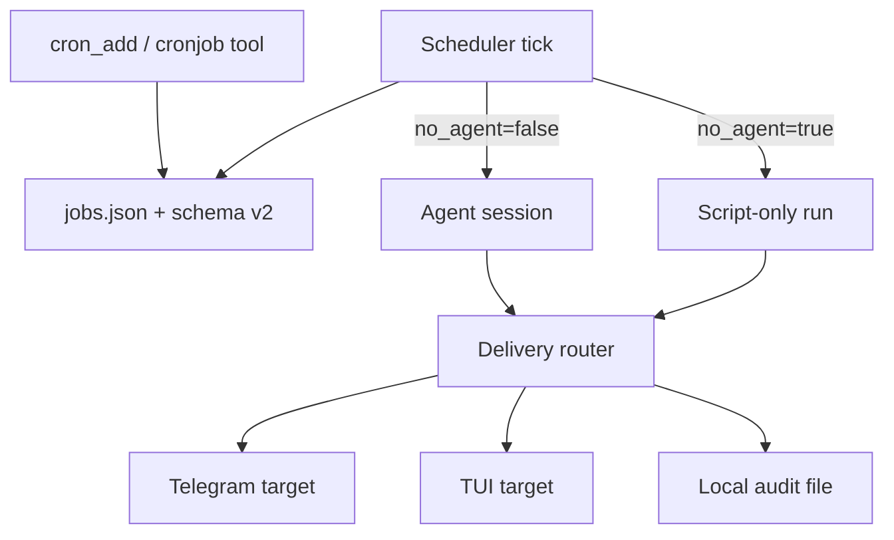

# Plan: Cron System — Full Hermes Hybrid (Implement Later)

## Goal

Evolve Valinor's cron from a minimal scheduler into a production-grade job system, adopting Hermes patterns incrementally. This is the **full roadmap** — implement in phases after [`cron-delivery-routing.md`](cron-delivery-routing.md) (Tier 1) is done.

## Current State

| Piece | Location | Gap |
|-------|----------|-----|
| Job schema | [`internal/cron/job.go`](../../internal/cron/job.go) | `message` + `schedule` only |
| Tools | [`internal/tools/cron.go`](../../internal/tools/cron.go) | add/list/remove/history |
| Scheduler | [`internal/scheduler/scheduler.go`](../../internal/scheduler/scheduler.go) | Broadcast-all delivery, `NO_REPLY` silence |
| Storage | `~/.valinor/cron/jobs.json` | JSON file |

## Target Architecture



---

## Phase 1: Delivery Routing (prerequisite — separate plan)

See [`cron-delivery-routing.md`](cron-delivery-routing.md). Must be done first.

---

## Phase 2: Lifecycle + Schema v2

### Extended `CronJob` schema

```go
type CronJob struct {
    // existing fields...
    DeliverTo   DeliveryTarget `json:"deliver_to"`
    CreatedBy   ClientRef      `json:"created_by,omitempty"`
    Paused      bool           `json:"paused"`           // replaces Enabled semantics or augments it
    Skills      []string       `json:"skills,omitempty"` // skill names to inject
    Workdir     string         `json:"workdir,omitempty"` // absolute workspace override
    NoAgent     bool           `json:"no_agent,omitempty"`
    Script      string         `json:"script,omitempty"`  // script name in ~/.valinor/scripts/
    WrapResponse bool          `json:"wrap_response,omitempty"`
}

type DeliveryTarget struct {
    Kind     string `json:"kind"`     // "origin" | "client" | "broadcast" | "local"
    Type     string `json:"type,omitempty"`     // "tui" | "telegram"
    Identity string `json:"identity,omitempty"`
}
```

### New tools / actions

| Tool | Actions |
|------|---------|
| `cron_pause` | Pause a job by ID |
| `cron_resume` | Resume + recompute next run |
| `cron_run` | Trigger on next tick (or immediately) |
| `cron_edit` | Update schedule, message, deliver_to, skills |

Or consolidate into single `cronjob` tool with `action` parameter (Hermes style) — reduces tool count.

### Loop prevention

In cron-executed sessions, exclude `cron_add` / `cron_edit` from the tool list. Pass a `RunContext` flag `IsCronSession=true` and filter in `BuildTools()`.

---

## Phase 3: Schedule Formats

Current: `every` (duration) + `at` (one-time).

Add:

| Format | Example | Parser |
|--------|---------|--------|
| Cron expression | `0 9 * * 1-5` | Use `github.com/robfig/cron/v3` |
| Natural language | `"every morning at 9am"` | Defer to agent at creation time; store resolved cron/interval |
| ISO timestamp | `2026-03-15T09:00:00Z` | Already supported via `at` |

Update `Schedule` struct:

```go
type Schedule struct {
    Kind    ScheduleKind `json:"kind"` // every | at | cron
    Every   string       `json:"every,omitempty"`
    At      time.Time    `json:"at,omitempty"`
    Cron    string       `json:"cron,omitempty"`  // cron expression
    AtZone  string       `json:"at_zone,omitempty"`
}
```

---

## Phase 4: Skills Attachment

When a cron job fires with `skills: ["weather", "monitoring"]`:

1. Load skill metadata from workspace `skills/` dir
2. Prepend skill content to the job message (or inject as a user message before the task)
3. Agent runs with skill context without the user manually loading skills

Implementation in [`internal/scheduler/scheduler.go`](../../internal/scheduler/scheduler.go) `buildJobMessage()`.

---

## Phase 5: `no_agent` Script-Only Jobs

For watchdog/monitoring jobs that don't need LLM reasoning.

### Behavior

| Condition | Action |
|-----------|--------|
| `no_agent=true` + script set | Run script from `~/.valinor/scripts/`, deliver stdout |
| Empty stdout | Silent tick (no delivery) |
| Non-zero exit | Deliver error alert |
| `no_agent=false` | Current agent flow |

### Script sandbox

- Scripts live in `~/.valinor/scripts/`
- `.sh` runs under bash; others under system interpreter
- Timeout configurable (default 120s)

### Agent can set these up

The `cron_add` tool schema gains `no_agent` and `script` params. Agent writes script via `write_file` to scripts dir, then creates job.

---

## Phase 6: Silent Suppression

Keep Valinor's `NO_REPLY` or adopt Hermes's `[SILENT]` — functionally identical.

| Marker | When |
|--------|------|
| `NO_REPLY` or `[SILENT]` | Agent decides nothing to report |
| Empty stdout (no_agent) | Script decides nothing to report |

Normalize in `normalizeScheduledJobContent()` — accept both markers.

---

## Phase 7: Response Wrapping

Optional header/footer on delivered cron output:

```text
Scheduled Job: Morning Check
─────────────────────────────
<agent output>
```

Config: `cron.wrap_response = true` (default true). TUI/Telegram renderers apply wrapping.

---

## Phase 8: Job Chaining (`context_from`)

Defer to v2. When job B fires, prepend job A's last output to job B's prompt. Requires local output store at `~/.valinor/cron/output/{job_id}/`.

---

## Phase 9: Scheduler Hardening

| Feature | Implementation |
|---------|----------------|
| Tick lock | File lock at `~/.valinor/cron/.tick.lock` to prevent overlapping ticks |
| Parallel job execution | Run independent jobs concurrently (except workdir jobs — serial) |
| Shorter tick interval | Configurable; Hermes uses 60s, Valinor uses 30m — add `check_interval = "60s"` option |

---

## Migration

1. Add `schema_version` to `jobs.json`
2. On load, v1 jobs get `deliver_to: { kind: "broadcast" }` as default
3. Backward-compatible: missing fields use sensible defaults

---

## Files Changed (across all phases)

| File | Phases |
|------|--------|
| `internal/cron/job.go` | 2, 3 |
| `internal/cron/store.go` | 2, migration |
| `internal/tools/cron.go` | 2, 5 |
| `internal/scheduler/scheduler.go` | 2, 4, 5, 6, 7 |
| `internal/gateway/router.go` | 1 (delivery) |
| `internal/event/payloads.go` | 1, 7 |
| `internal/telegram/renderer.go` | 7 |
| `internal/tui/model.go` | 7 |
| `internal/config/config.go` | 5, 7, 9 |
| `config.example.toml` | all |

---

## Implementation Order

1. **Now:** [`cron-delivery-routing.md`](cron-delivery-routing.md)
2. Pause/resume/edit + loop prevention
3. `[SILENT]` alias + response wrapping
4. Skills attachment
5. Cron expressions
6. `no_agent` script mode
7. Tick lock + parallel execution
8. `context_from` chaining (optional)

---

## Estimated Effort

- Phases 2–3: ~2 days
- Phase 4–5: ~2 days
- Phases 6–9: ~2 days
- **Total:** ~1 week spread across sprints

## Out of Scope

- 20-platform delivery strings (Valinor has TUI + Telegram only)
- Natural language schedule parsing at runtime (agent resolves at creation)
- Provider fallback for cron (separate concern)