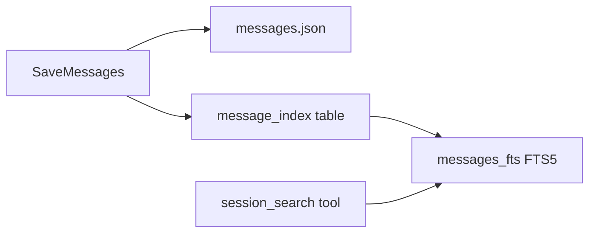

# Plan: Session Search (FTS5)

## Goal

Let the agent search past conversations by keyword, answering "what did we discuss last week?" without loading full history into context or paying LLM summarization costs.

## Current State

- Session metadata in SQLite: [`internal/session/metadata_repo.go`](../../internal/session/metadata_repo.go) (`metadata.db`)
- Messages in per-session JSON files: `{session_dir}/{id}/messages.json`
- No cross-session search, no message indexing
- Memory system only covers curated `MEMORY.md` content

## Design

### Storage: Extend SQLite with FTS5

Add a `messages_fts` virtual table to the existing `metadata.db` (or a new `search.db` — prefer extending existing DB to avoid two SQLite files).

```sql
CREATE TABLE IF NOT EXISTS message_index (
    id          INTEGER PRIMARY KEY AUTOINCREMENT,
    session_id  TEXT NOT NULL,
    message_idx INTEGER NOT NULL,  -- position in messages.json array
    role        TEXT NOT NULL,
    content     TEXT NOT NULL,
    created_at  TEXT NOT NULL,     -- session updated_at or message timestamp
    UNIQUE(session_id, message_idx)
);

CREATE VIRTUAL TABLE IF NOT EXISTS messages_fts USING fts5(
    content,
    role,
    session_id,
    content='message_index',
    content_rowid='id'
);

-- Triggers to keep FTS in sync
CREATE TRIGGER messages_fts_insert AFTER INSERT ON message_index BEGIN
    INSERT INTO messages_fts(rowid, content, role, session_id)
    VALUES (new.id, new.content, new.role, new.session_id);
END;
-- (update/delete triggers similarly)
```

### Indexing Strategy

**On write:** When [`internal/session/file_store.go`](../../internal/session/file_store.go) `SaveMessages()` persists messages, index new/changed messages.

**On startup:** Background reindex pass for any sessions not yet indexed (migration).

**What to index:**

| Role | Index? | Notes |
|------|--------|-------|
| `user` | Yes | User queries |
| `assistant` | Yes | Agent responses (skip empty tool-call-only messages) |
| `tool` | Yes, truncated | Index first 500 chars of tool results (avoid bloating index with file dumps) |
| `system` | No | Static per session |

### Search Tool

New agent tool: `session_search`

```json
{
  "query": "database migration",
  "session_id": "optional — search within one session",
  "limit": 10,
  "before": "optional session_id for pagination"
}
```

**Response format:**

```json
{
  "results": [
    {
      "session_id": "abc-123",
      "session_title": "Database refactor",
      "message_idx": 14,
      "role": "assistant",
      "snippet": "...decided to use SQLite for metadata with FTS5...",
      "date": "2026-06-15T10:30:00Z"
    }
  ],
  "total": 3
}
```

Snippets use FTS5 highlighting or simple context extraction around the match.

### Scroll Tool (optional v1.1)

`session_read` — read messages around a hit:

```json
{
  "session_id": "abc-123",
  "around_message_idx": 14,
  "window": 5
}
```

Returns 5 messages before and after the hit. Deferred to v1.1 if scope is tight.

---

## Implementation Steps

### 1. Search repository

**New file:** [`internal/session/search_repo.go`](../../internal/session/search_repo.go)

```go
type SearchRepository interface {
    IndexMessages(ctx context.Context, sessionID string, messages []agentcontext.Message, updatedAt time.Time) error
    Search(ctx context.Context, query string, opts SearchOptions) ([]SearchResult, error)
    DeleteSession(ctx context.Context, sessionID string) error
    ReindexAll(ctx context.Context, sessionDir string) error
}

type SearchOptions struct {
    SessionID string
    Limit     int
    Offset    int
}
```

Implement `SQLiteSearchRepository` with FTS5 queries:

```sql
SELECT session_id, message_idx, role, snippet(messages_fts, 0, '>>>', '<<<', '...', 32) as snippet
FROM messages_fts
WHERE messages_fts MATCH ?
ORDER BY rank
LIMIT ?
```

### 2. Schema migration

**File:** [`internal/session/metadata_repo.go`](../../internal/session/metadata_repo.go)

Add `initSearchSchema()` called from `NewSQLiteMetadataRepository`. Create tables + triggers.

### 3. Hook indexing into SaveMessages

**File:** [`internal/session/file_store.go`](../../internal/session/file_store.go)

After atomic write to `messages.json`, call `searchRepo.IndexMessages()`. Use incremental indexing: compare message count, only index new messages.

### 4. Search tool

**New file:** [`internal/tools/session_search.go`](../../internal/tools/session_search.go)

Register in [`internal/tools/tools.go`](../../internal/tools/tools.go) as `ParallelSafe: true`.

### 5. Wire search repo at startup

**File:** [`cmd/valinor/main.go`](../../cmd/valinor/main.go)

Create `SearchRepository` alongside metadata repo. Pass to session manager.

**File:** [`internal/session/manager.go`](../../internal/session/manager.go)

Hold reference to search repo; expose to tools via `SetSearchRepository()` (same pattern as `SetCronService`).

### 6. Startup reindex

On gateway start, spawn background goroutine:

```go
go searchRepo.ReindexAll(ctx, sessionDir)
```

Log progress; non-blocking.

### 7. System prompt update

**File:** [`internal/context/system_prompt.md`](../../internal/context/system_prompt.md)

```markdown
## Session History

You can search past conversations with `session_search` when the user
references something from a previous session or you need to recall a
past decision. Use specific keywords, not full sentences.
```

### 8. CLI listing (optional)

```bash
valinor sessions list    # future CLI subcommand
```

Defer to v1.1.

---

## Testing

| Test | File | Asserts |
|------|------|---------|
| Index + search roundtrip | `search_repo_test.go` | Insert messages, FTS query returns match |
| Incremental indexing | `search_repo_test.go` | Only new messages indexed on second save |
| Delete session cleans index | `search_repo_test.go` | FTS entries removed |
| Tool integration | `session_search_test.go` | Tool returns formatted results |
| Special chars in query | `search_repo_test.go` | FTS5 query escaping (quotes, AND/OR) |

### FTS5 query escaping

Wrap user queries safely — FTS5 uses special syntax. Simple approach: quote the entire query and strip internal quotes.

---

## Architecture



---

## Files Changed

| File | Change |
|------|--------|
| `internal/session/search_repo.go` | New FTS5 repository |
| `internal/session/search_repo_test.go` | Tests |
| `internal/session/metadata_repo.go` | Schema init for search tables |
| `internal/session/file_store.go` | Index on save |
| `internal/session/manager.go` | Hold search repo reference |
| `internal/tools/session_search.go` | New tool |
| `internal/tools/tools.go` | Register tool |
| `cmd/valinor/main.go` | Wire search repo |
| `internal/context/system_prompt.md` | Document session_search |

---

## Dependencies

None — `modernc.org/sqlite` (already in `go.mod`) supports FTS5.

---

## Estimated Effort

~2 days.

## Success Criteria

- Agent can find past conversation content by keyword
- Indexing happens automatically on message save
- Startup reindex covers existing sessions
- Search returns snippets in <50ms for typical query
- No impact on normal session save latency (indexing is synchronous but fast for incremental updates)

## Relationship to Memory Plan

Session search complements [`memory-improvements.md`](memory-improvements.md):
- **Memory** = always-on curated facts (~1k tokens)
- **Session search** = on-demand recall of full conversation history (free, no LLM cost)